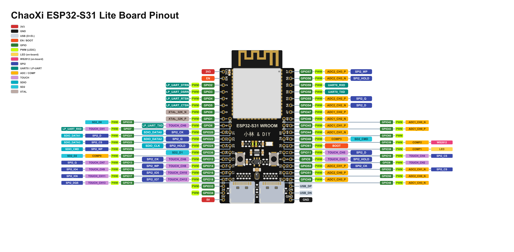

# CX0001 ESP32-S31 Module Lite Board

基于 **ESP32-S31**（片上 Wi-Fi 6 + 蓝牙 5.4 + USB-OTG + USB-Serial-JTAG）的精简开发板资料与 **ESP-IDF v6.1.0** 示例教程。

**CX 产品教程站（总目录）：** [CX_Product_Tutorials](https://zhentao-lin.github.io/CX_Product_Tutorials/) → 产品 **CX0001 ESP32-S31 Module Lite**（概述 + 本章外链索引）。



排针编号、电源/地、USB 口与板载 LED / BOOT / WS2812 等外设 GPIO，见上图引脚图（原图：[06.Picture/Pinout_CX0001.png](06.Picture/Pinout_CX0001.png)）。下方 **板级引脚** 表为教程示例中常用的固定引脚。

## 快速开始

1. 安装环境：阅读 **[04.教程/00_开发环境.md](04.教程/00_开发环境.md)**（GitHub 上渲染 Markdown）。**排版版教程**请点开 **[网页目录](https://zhentao-lin.github.io/CX0001_ESP32_S31_Module_Lite_Board/index.html)**（GitHub Pages）；本地克隆后也可用浏览器直接打开 `04.教程\index.html`（勿点仓库里的 `index.html` 链接，那会显示 HTML 源码）。
2. 按下方 **教程索引** 从 01 章顺序学习到 09 章；每章对应 `03.Sketch` 下的独立工程。
3. 工程路径请使用**纯 ASCII**（勿含中文/空格）；目标芯片 `esp32s31`，`idf.py` 需带 **`--preview`**。

```powershell
cd <仓库路径>\03.Sketch\01_GPIO_LED
idf.py --preview set-target esp32s31
idf.py --preview menuconfig
idf.py --preview build
idf.py --preview -p <COM口> flash monitor
```

## 教程索引（01～09）

| 章 | 主题 | 教程 |
|:--:|------|------|
| 01 | GPIO 输出 / 板载 LED | [01_GPIO_LED.md](04.教程/01_GPIO_LED.md) |
| 02 | GPIO 输入 / BOOT 键 | [02_GPIO_BUTTON.md](04.教程/02_GPIO_BUTTON.md) |
| 03 | WS2812 RGB | [03_WS2812.md](04.教程/03_WS2812.md) |
| 04 | USB 串口控制台 | [04_USB_SERIAL.md](04.教程/04_USB_SERIAL.md) |
| 05 | USB 虚拟 U 盘 | [05_USB_MSC.md](04.教程/05_USB_MSC.md) |
| 06 | BLE NUS 透传 | [06_BLE_UART.md](04.教程/06_BLE_UART.md) |
| 07 | BLE 控灯 | [07_BLE_LED.md](04.教程/07_BLE_LED.md) |
| 08 | Wi-Fi Socket | [08_WIFI_SOCKET.md](04.教程/08_WIFI_SOCKET.md) |
| 09 | 网页控 WS2812 | [09_WEB_WS2812.md](04.教程/09_WEB_WS2812.md) |

## 板级引脚

| 项目 | 值 |
|------|-----|
| 板载 LED | **GPIO38**（高有效） |
| BOOT 按键 | **GPIO61**（低有效） |
| WS2812 数据 | **GPIO39**（GRB，板载 1 颗） |
| 烧录 / 日志 | **USB-Serial-JTAG**（免驱 COM 口） |
| USB Device（如 MSC） | **USB-OTG**（与烧录口不是同一 Type-C） |
| Flash / PSRAM | 16 MB / 16 MB |

## 仓库目录

| 目录 | 说明 |
|------|------|
| [01.原理图](01.原理图/) | 原理图 PDF |
| [02.PCB](02.PCB/) | PCB 资料 |
| [03.Sketch](03.Sketch/) | ESP-IDF 示例工程（01～09） |
| [04.教程](04.教程/) | 中文教程（[网页目录](https://zhentao-lin.github.io/CX0001_ESP32_S31_Module_Lite_Board/index.html) / [目录说明](04.教程/README.md) / `.md` 源文件） |
| [05.Datasheet](05.Datasheet/) | 芯片 / 模组数据手册 |
| [06.Picture](06.Picture/) | 板卡实物与引脚图 |

## 许可与说明

示例代码遵循各源文件中的 SPDX 许可声明。教程与工程针对 **CX0001** 板级引脚与分区表适配，换板时请优先修改 Kconfig / `sdkconfig.defaults` 与引脚宏。